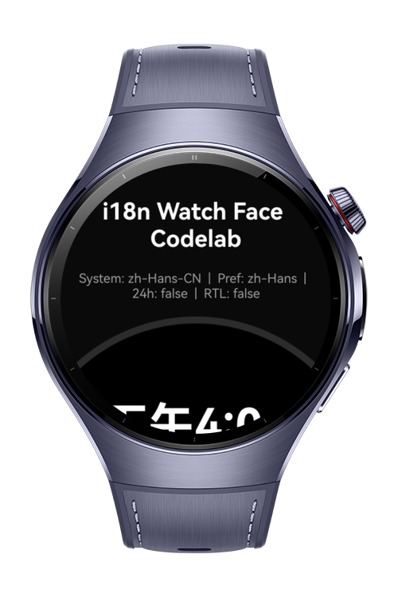
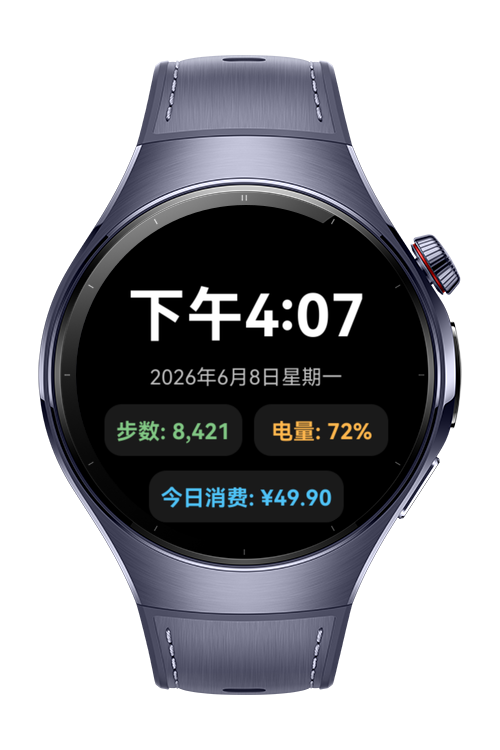
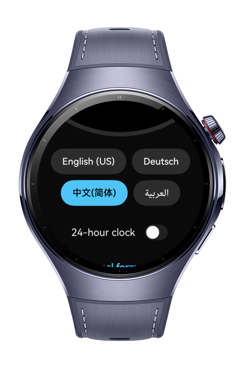
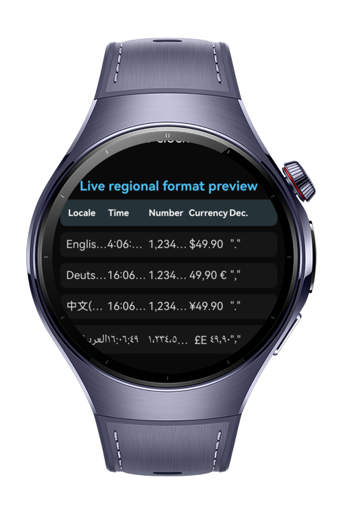

> **Note:** To access all shared projects, get information about environment setup, and view other guides, please visit [Explore-In-HMOS Index](https://github.com/Explore-In-HMOS/hmos-index).

# How to Build Multilingual Watch

Build a smartwatch face that dynamically switches language, and date / number /
time / currency formats based on the user's locale — with a live preview panel
showing how the same values render across regional conventions (24h vs 12h,
comma vs dot decimals, currency symbols, RTL).

# Preview

<div>
  
  
  
  
</div>

# Use Cases

MultilingualWatch provides:

- Large live time + full localized date.
- Three complications (steps, battery %, today's spend) whose **labels** come
  from locale resource files and whose **values** are formatted by `intl`.
- A language picker (English, Deutsch, 中文, العربية).
- A 12/24-hour toggle.
- A "Live regional format preview" table rendering the same instant and the
  same numbers across all four locales simultaneously.

All per-frame string assembly happens on a **Worker thread**, which receives the
`resourceManager` as a thread-safe `SendableResourceManager`.

# Tech Stack

| Capability                  | Module / Tech                                |
|-----------------------------|----------------------------------------------|
| Languages                   | ArkTS, Typescript                            |
| Frameworks                  | HarmonyOS SDK 6.0.1(21)                      |
| Tools                       | DevEco Studio Version 6.0                    |
| Locale-aware formatting     | `@ohos.intl`                                 |
| Globalization               | `@ohos.i18n` (`i18n.System`)                 | 
| Resource loading            | `resourceManager`                            | 
| Thread-safe resource access | `SendableResourceManager`                    |
| Sendable lifecycle          | `sendableResourceManager` create/get/release |

---

# Directory Structure

```
multilingual-watch/
├── AppScope/
│   ├── app.json5
│   └── resources/base/element/string.json
├── build-profile.json5
├── oh-package.json5
└── entry/
    ├── build-profile.json5            # registers the worker source
    └── src/main/
        ├── module.json5
        ├── ets/
        │   ├── common/EntryAbility.ets
        │   ├── model/
        │   │   ├── LocaleFormatter.ets       # @ohos.intl wrapper
        │   │   ├── Globalization.ets         # @ohos.i18n wrapper
        │   │   ├── StringResources.ets       # resourceManager wrapper
        │   │   ├── SendableResources.ets     # sendable lifecycle helpers
        │   │   └── LocaleCatalog.ets         # supported locales metadata
        │   ├── components/
        │   │   ├── Complication.ets
        │   │   ├── WatchDial.ets
        │   │   └── FormatPreview.ets
        │   ├── pages/Index.ets               # main page, wires it all
        │   └── workers/format.worker.ets     # off-thread formatting
        └── resources/
            ├── base/element/{string,color}.json
            ├── base/profile/main_pages.json
            ├── en_US/element/string.json
            ├── de_DE/element/string.json
            ├── zh_CN/element/string.json
            └── ar_EG/element/string.json
```

---

# Constraints and Restrictions
## Limitations
**Target device:** Any Huawei wearable (also runs on phone). 
**API level:** 12+ (HarmonyOS 5.0).
**Supported locales:** *en*,*de*,*ar*,*cn*

## Supported Devices

- Huawei Watch 5
- HarmonyOS wearable emulator

# License

MultilingualWatch is distributed under the terms of the MIT License.
See the [LICENSE](./LICENSE). for more information.